# ToPu_SmartSelectTools

Blender の選択まわりを強化するアドオンです。
オブジェクト/頂点/辺/面それぞれに便利な選択コマンドを追加し、さらに **ホイールでのループ・リング段階選択**、**ワンボタン削除**、**メッシュ最適化** をまとめて使えるようにします。

- 対応バージョン: Blender 4.2 以降（4.2 / 5.1 で動作確認）
- UI 言語: 日本語 / English（Blender の言語設定に合わせて自動で切り替わります）

[English summary is below.](#english)

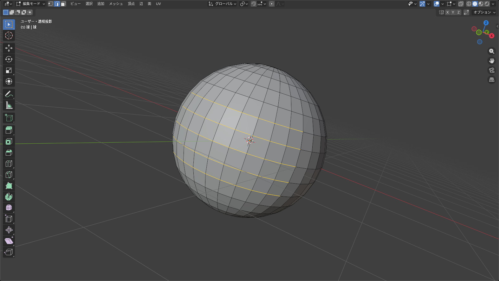

---

## 目次

- [インストール](#インストール)
- [初期設定ポップアップ](#初期設定ポップアップ)
- [ループ/リング段階選択（Alt+ホイール / Ctrl+Alt+ホイール）](#ループリング段階選択altホイール--ctrlaltホイール)
- [オブジェクトモードの選択コマンド](#オブジェクトモードの選択コマンド)
- [編集モードの選択コマンド（頂点 / 辺 / 面）](#編集モードの選択コマンド頂点--辺--面)
- [ワンボタン削除（X）と元の削除メニュー（Alt+X）](#ワンボタン削除xと元の削除メニューaltx)
- [メッシュを最適化](#メッシュを最適化)
- [アドオンプリファレンス](#アドオンプリファレンス)
- [言語の自動切り替え](#言語の自動切り替え)
- [注意事項](#注意事項)
- [クレジット](#クレジット)
- [ライセンス](#ライセンス)

---

## インストール

1. [Releases](https://github.com/http4211/ToPu_SmartSelectTools/releases) から `ToPu_SmartSelectTools_x.x.x.zip` をダウンロードします（zip は解凍しないでください）。
2. Blender で **編集 > プリファレンス > アドオン** を開き、右上の **▼ > ディスクからインストール** で zip を選びます。
3. `ToPu_SmartSelectTools` にチェックを入れて有効化します。

> 以前のバージョンを入れている場合は、一度アンインストールしてからインストールしてください。
> `ToPu_Delete` を使っている場合は、機能が統合されたので無効化してください（X キーが重複します）。

---

## 初期設定ポップアップ

アドオンを有効にすると、どのショートカットを使うかを選ぶポップアップが表示されます。
後からアドオンプリファレンスでいつでも変更できます。

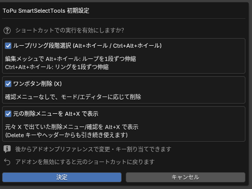

| 項目 | 既定キー | 内容 |
|---|---|---|
| ループ/リング段階選択 | Alt+ホイール / Ctrl+Alt+ホイール | 編集メッシュでループ/リングを1段ずつ伸縮 |
| ワンボタン削除 | X | 確認メニューなしで、モード/エディターに応じて削除 |
| 元の削除メニュー | Alt+X | 元々 X で出ていた削除メニュー/確認を表示 |

**アドオンを無効にすると、すべて元のショートカットに戻ります。**（Blender 本来のキーマップは書き換えていません）

---

## ループ/リング段階選択（Alt+ホイール / Ctrl+Alt+ホイール）

編集メッシュで、選択中のループやリングを **1段ずつ** 伸ばしたり縮めたりできます。

| 操作 | 動作 |
|---|---|
| **Alt + ホイール上 / 下** | ループ方向に1段ずつ拡張 / 縮小 |
| **Ctrl + Alt + ホイール上 / 下** | リング方向に1段ずつ拡張 / 縮小 |
| 修飾キーを押したままホイール | 何段でも増減（アンドゥは1回分にまとまります） |
| 修飾キーを離す / Enter | 確定 |
| 右クリック / Esc | キャンセル（元の選択に戻る） |

- **辺・頂点選択モード**: 選択した辺の端からループを延長、またはリング方向に平行な辺を追加します。ポールや境界でも自然に止まります。
- **面選択モード**: Alt はつながった面の列（面ストリップ）を延長します。1枚だけ選んでいる場合はビューの横方向に伸ばします。Ctrl+Alt は選択範囲の拡大/縮小です。
- 実行後は左下のパネルで「段数」を調整できます。

---

## オブジェクトモードの選択コマンド

ヘッダーの **選択** メニューと **Shift+G（グループで選択）** に追加されます。

<table>
<tr>
<th>選択メニュー</th>
<th>Shift+G（グループで選択）</th>
</tr>
<tr>
<td valign="top">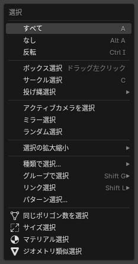</td>
<td valign="top">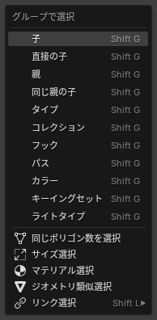</td>
</tr>
</table>

| コマンド | 内容 |
|---|---|
| **同じポリゴン数を選択** | アクティブと同じポリゴン数のメッシュを選択（モディファイア込み/元メッシュを切り替え可） |
| **サイズ選択** | アクティブと同じ / 大きい / 小さいオブジェクトを選択（見た目サイズ or スケール未適用サイズ、許容誤差あり） |
| **マテリアル選択** | アクティブと同じマテリアルを持つオブジェクトを選択（1つでも一致 / すべて含む / 完全一致） |
| **ジオメトリ類似選択** | 頂点配置が一定割合以上一致するメッシュを選択（許容距離・最小一致率・頂点数許容） |
| **リンク選択**（Shift+G 内） | Blender 標準のリンク選択を Shift+G からも呼び出せます |

---

## 編集モードの選択コマンド（頂点 / 辺 / 面）

ヘッダーの **選択** メニューと **Shift+G（類似選択）** に、選択モードに合わせたコマンドが追加されます。

### 頂点選択モード

<table>
<tr>
<th>選択メニュー</th>
<th>Shift+G（類似選択）</th>
</tr>
<tr>
<td valign="top">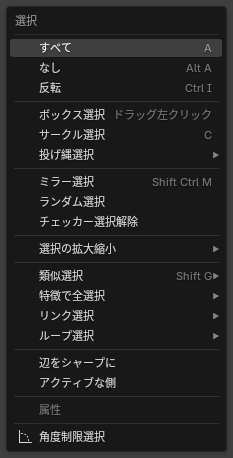</td>
<td valign="top">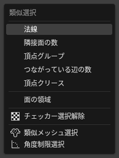</td>
</tr>
</table>

### 辺選択モード

<table>
<tr>
<th>選択メニュー</th>
<th>Shift+G（類似選択）</th>
</tr>
<tr>
<td valign="top">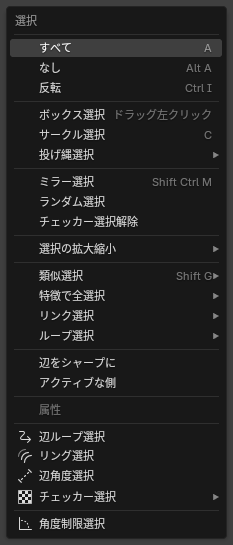</td>
<td valign="top">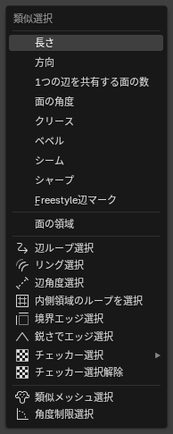</td>
</tr>
</table>

### 面選択モード

<table>
<tr>
<th>選択メニュー</th>
<th>Shift+G（類似選択）</th>
</tr>
<tr>
<td valign="top">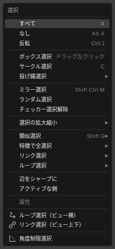</td>
<td valign="top">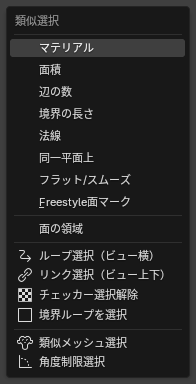</td>
</tr>
</table>

### コマンド一覧

| コマンド | モード | 内容 |
|---|---|---|
| **辺ループ選択 / リング選択** | 辺 | ループ/リング選択。Shift で段階的な拡大、Ctrl で角度制限を使用 |
| **辺角度選択** | 辺 | 選択中の辺の端から、許容角度以内で続く辺だけを追加選択 |
| **チェッカー選択**（ループ / リング） | 辺 | ループ/リング上で「n本選択・m本スキップ」を繰り返して選択。起点の軸・向きを指定可 |
| **境界エッジ選択** | 辺 | アクティブエッジから、裸エッジや凹凸の境界をつながりで選択 |
| **鋭さでエッジ選択** | 辺 | 面の角度がしきい値以上の辺をオブジェクト全体から選択 |
| **内側領域のループを選択 / 境界ループを選択** | 辺 / 面 | Blender 標準コマンドを Shift+G から呼び出し |
| **ループ選択（ビュー横） / リンク選択（ビュー上下）** | 面 | 今の視点から見て左右 / 上下方向に、四角面をたどって面を選択。Ctrl で角度制限 |
| **チェッカー選択解除** | 全モード | Blender 標準コマンドを Shift+G から呼び出し |
| **類似メッシュ選択** | 全モード | 選択した要素と形状（面積・角度・辺の長さ）が似ている面 / 辺 / 頂点をメッシュ内から選択 |
| **角度制限選択** | 全モード | 選択要素の面から、法線角がしきい値以下の隣接面へ選択を広げる |

---

## ワンボタン削除（X）と元の削除メニュー（Alt+X）

**X** で、確認メニューを出さずにその場の対象を削除します。
元々 X で出ていた削除メニューや確認付き削除は **Alt+X** で呼び出せます（Delete キーやヘッダーのメニューからも従来どおり使えます）。

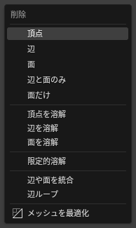

| 場所 | X で削除されるもの |
|---|---|
| 3D ビュー：オブジェクトモード | 選択オブジェクト |
| 編集：メッシュ | 選択モードに応じて 頂点 / 辺 / 面 |
| 編集：カーブ・サーフェス / カーブ(毛) / ポイントクラウド | 選択した点 |
| 編集：メタボール / アーマチュア / グリースペンシル | 選択要素 / ボーン / 点 |
| パーティクル編集 | 選択パーティクル |
| アウトライナー / ノード / NLA / シーケンサー | 選択項目 |
| グラフエディター / ドープシート | 選択キーフレーム |
| クリップエディター / マスク編集 | 選択トラック / マスク点 |
| プロパティエディター | アクティブなモディファイア / コンストレイント / ボーンコンストレイント / エフェクト / マテリアルスロット / パーティクルシステム |

- テキスト編集モードでは X に割り当てていません（文字の「x」を入力できるようにするため）。
- キーはアドオンプリファレンスで「全エディター共通」または「エディターごと」に変更できます。

---

## メッシュを最適化

編集メッシュの **削除メニュー（Alt+X / Delete）** と **メッシュ > クリーンアップ** に追加されます。
形状を保ったまま、不要な頂点や辺を整理します。

- 内部面・孤立した頂点/辺の削除
- 平らな部分の溶解（角度制限）
- 重複・縮退した辺/面の除去（結合距離）
- 直線上にある頂点の溶解
- 裏返って重なった面の修正

実行後のパネルで、**選択面のみ**、反復回数、結合距離、角度制限、三角面化、シーム/シャープ/マテリアル境界の維持などを調整できます。

> 「選択面のみ」がオフで「内部面を削除」がオンの場合、処理の都合で選択は解除されます。

---

## アドオンプリファレンス

各ショートカットの有効/無効とキー割り当てを変更できます。変更したキーは Blender の再起動後も保持されます。

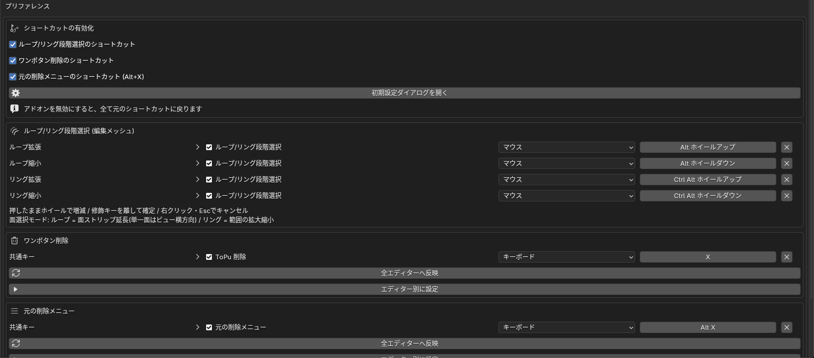

---

## 言語の自動切り替え

UI は英語と日本語に対応しており、Blender の **プリファレンス > インターフェース > 翻訳** の言語に合わせて自動で切り替わります（日本語以外の言語では英語で表示されます）。

- 翻訳の「インターフェース」「ツールチップ」「レポート」がオフの項目は英語で表示されます。
- Blender 本体に訳がある語は、Blender 側の訳が表示されます（本体のメニューと用語がそろいます）。

---

## 注意事項

- **AV: ResampleMesh** など、Alt+ホイールを使う他のアドオンと併用する場合は、どちらかのショートカットを無効にしてください。
- **ToPu_Delete** の機能はこのアドオンに統合されています。両方を有効にすると X キーが重複します。

---

## クレジット

- 作者: [http4211](https://github.com/http4211)
- 「類似メッシュ選択」は Kushiro 氏の **select_sim 1.0.2** を統合したものです。
- ループ/リング段階選択のホイール操作は **AV: ResampleMesh**（Anton Vashkevich 氏）の操作感を参考にしています（コードは独自実装です）。

---

## ライセンス

このアドオンは [GNU General Public License v3.0 or later](LICENSE)（GPL-3.0-or-later）で公開しています。
改変・再配布は自由ですが、配布する場合は同じ GPL-3.0 以降のライセンスでソースコードを公開する必要があります。詳しくは [LICENSE](LICENSE) をご覧ください。

---

## English

**ToPu_SmartSelectTools** adds selection tools for Object / Vertex / Edge / Face modes to Blender 4.2+.
The UI follows Blender's interface language automatically (Japanese / English).

- **Loop/Ring Step Select**: In Edit Mesh, `Alt + Wheel` grows/shrinks the selected loop one step at a time, `Ctrl + Alt + Wheel` does the same for rings. Keep scrolling while holding the modifiers, release to confirm, right-click/Esc to cancel. In face mode, Alt extends a face strip and Ctrl+Alt grows/shrinks the region.
- **Object Mode** (Select menu / Shift+G): Select Same Polycount, Select by Size, Select by Material, Select Similar Geometry.
- **Edit Mode** (Select menu / Shift+G): Edge Loop/Ring Select with growth and angle limits, Edge Angle Select, Checker Loop/Ring Select, Select Boundary Edges, Select Edges by Sharpness, Loop Select (View Horizontal) / Link Select (View Vertical) for faces, Select Similar Mesh, Angle Limit Select.
- **One-Button Delete (`X`)**: Deletes without a confirmation menu in the 3D View (Object / all edit modes / Particles), Outliner, Node, Graph, Dope Sheet, NLA, Sequencer, Clip, Mask and the Properties editor (active modifier, constraint, etc.). The original X menu moves to `Alt + X`.
- **Optimize Mesh**: Added to the Edit Mesh Delete menu and Mesh > Clean Up. Cleans up unnecessary vertices and edges while keeping the shape.
- A setup popup on first enable lets you choose which shortcuts to use. Every shortcut can be changed in the add-on preferences, and disabling the add-on restores the original shortcuts.

**License:** [GPL-3.0-or-later](LICENSE)
